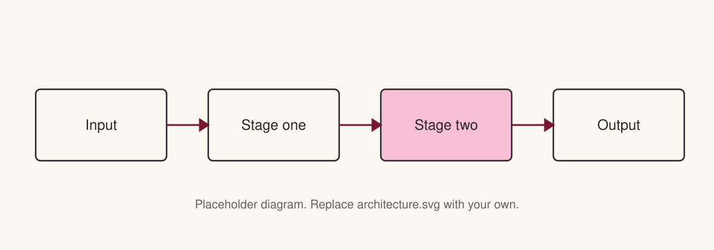

## Overview

Start with two or three sentences on what the project is and who it is for. A reader who stops
here should still know what you built.

Then state the problem: what was hard, slow, or missing before this project existed.

## Motivation and objectives

Explain why the problem was worth solving, then list what the project set out to do.

- First objective, written so that someone could check whether it was met.
- Second objective.
- Anything that was deliberately out of scope.

## Approach and architecture

Describe the system at a high level before going into detail. A diagram usually helps.

<Figure caption="Replace with your own architecture diagram. Images live in the same folder as this file.">



</Figure>

### Tools and technologies

| Layer | Choice | Why |
| --- | --- | --- |
| Model | Which model or family | The reason it suited this problem |
| Retrieval | Vector store, index, or none | What it needed to handle |
| Orchestration | Framework or custom code | The trade-off you made |
| Deployment | Where and how it runs | Cost, latency, or simplicity |

## Implementation

Walk through the parts that were interesting to build. Code blocks are highlighted automatically.

```python
# Example snippet. Replace with code from the project.
def answer(question: str, retriever, llm) -> str:
    """Retrieve supporting passages, then generate a grounded answer."""
    passages = retriever.search(question, k=5)
    prompt = build_prompt(question, passages)
    return llm.generate(prompt)
```

Inline code such as `retriever.search()` is styled too.

<Callout title="Design decision">
  Use a callout for a decision, caveat, or warning that should stand apart from the main text.
</Callout>

## Live demo

If the project has an interactive demo, embed it here so readers can try it without leaving the
page. The block below is empty because this template has no demo.

<Demo title="Live demo" />

## Results and evaluation

Report how the project performed and how you measured it. Tables suit metric comparisons.

| Configuration | Metric one | Metric two | Notes |
| --- | --- | --- | --- |
| Baseline | n/a | n/a | Replace with real results |
| Final system | n/a | n/a | Replace with real results |

### Limitations

Say plainly where the system falls short, what it was not tested on, and what you would not trust
it to do.

## Key learnings

1. Something that worked better than expected, and why.
2. Something you would do differently next time.
3. An open question the project left you with.

## Links

The buttons at the top of the page come from the `repo`, `demo` and `docs` fields at the top of
this file. Leave a field out and its button disappears.
